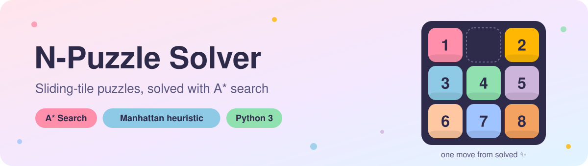
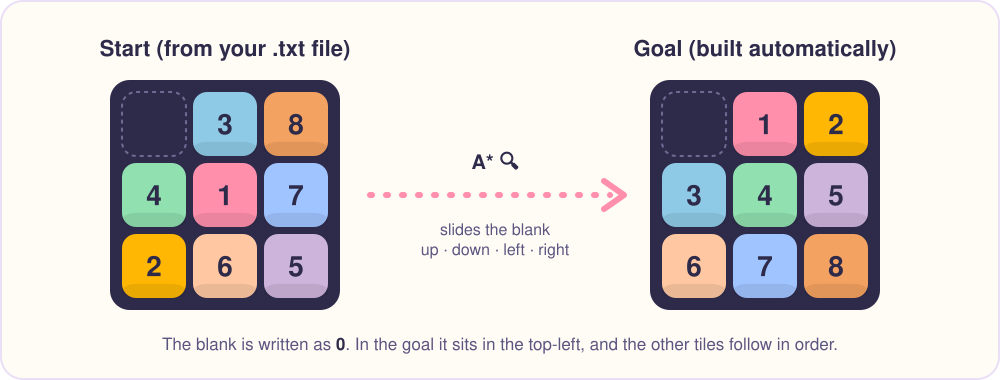
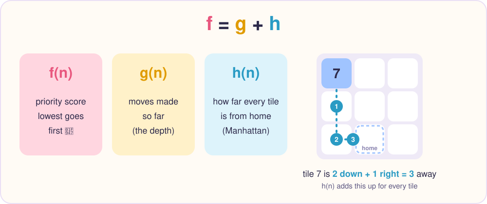
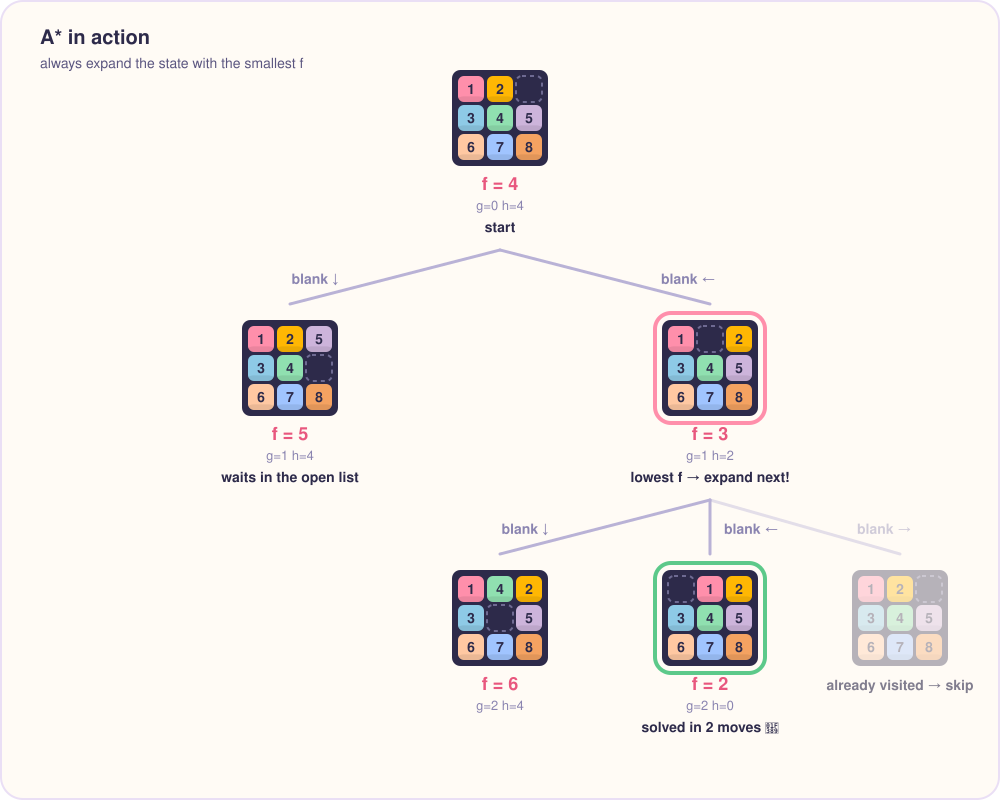
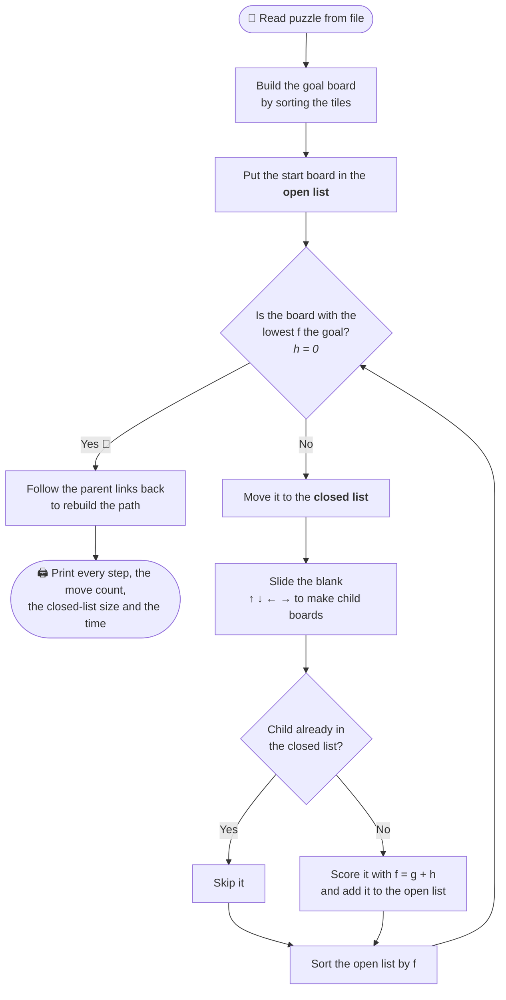

<div align="center">



<br/>


**An AI solver for the classic sliding-tile puzzle (8-puzzle, 15-puzzle and beyond).**<br/>
Give it a scrambled board and it finds the sequence of moves that puts every tile back in order.

[How it works](#-how-it-works) · [Quick start](#-quick-start) · [Example](#-example-run) · [Project structure](#-project-structure)

</div>

---

## 🧩 What is the N-Puzzle?

The N-Puzzle is a grid of numbered tiles with **one empty space**. You can only slide a tile into the empty space next to it, and the goal is to get every tile back into order.

It looks simple, but the number of possible boards grows fast: a 3×3 board already has **181,440** reachable arrangements, and a 4×4 has over **10 trillion**. Trying them all would take far too long, so this project uses **A\* search**, a classic AI algorithm that focuses on the moves most likely to lead to the goal.

<p align="center">
  
</p>

> **Any size works.** The solver reads the board size from your input file and builds the goal board itself: the blank (`0`) goes in the top-left corner and the other tiles follow in order.

---

## 🧠 How it works

### Scoring each board: `f = g + h`

A\* gives every board it sees a score, then always looks at the **lowest-scoring board next**.

<p align="center">
  
</p>

| Term | Meaning | In the code |
|:---:|---|---|
| **g** | Number of moves made to reach this board | `State.depth` |
| **h** | Sum of the **Manhattan distances**: how many rows and columns each tile is from its home spot | `Puzzle.h_score()` |
| **f** | `g + h`: the total score used to decide what to explore next | `Puzzle.f_score()` |

### A* in action

Here is a tiny 3×3 example. The scores shown are the same `f` values the program prints.

<p align="center">
  
</p>

### The algorithm loop



---

## 🚀 Quick start

**Requirements:** Python 3. Nothing else to install, since the solver only uses the standard library.

```bash
git clone https://github.com/fg20-cs/AI_Npuzzle_Astar.git
cd AI_Npuzzle_Astar
python3 npuzzle.py 3-puzzle-1.txt
```

### Input format

A plain text file with one board row per line, numbers separated by spaces or tabs, and `0` for the blank:

```text
0 3 8
4 1 7
2 6 5
```

---

## 🖥️ Example run

For a board that is two moves from solved, the program prints each step with its `f` score (the blank is printed as `-`):

```text
start state:
1   2   -
3   4   5
6   7   8

goal state:
-   1   2
3   4   5
6   7   8

Steps taken:
F_score:  4
1   2   -
3   4   5
6   7   8

F_score:  3
1   -   2
3   4   5
6   7   8

F_score:  2
-   1   2
3   4   5
6   7   8

Number of moves to reach goal state: 2 moves
Number of states in closed list:  2
Time to reach goal state:  ...  seconds
```

---

## 📁 Project structure

```text
AI_Npuzzle_Astar/
├── npuzzle.py          # the solver: State, Puzzle and A* search
├── 3-puzzle-1.txt      # 3×3 sample boards
├── 3-puzzle-2.txt
├── 4-puzzle-1.txt      # 4×4 sample boards
├── 4-puzzle-2.txt
├── 5-puzzle-1.txt
└── assets/             # README graphics
```

| Component | Role |
|---|---|
| `State` | One board: its tiles, its depth (`g`), its `f` score and the parent it came from. Creates child boards by sliding the blank. |
| `Puzzle` | Holds the open and closed lists, computes the heuristic and runs `solve_with_A_star()`. |
| `generate_goal_state()` | Builds the goal board for any board size. |

---

## 💡 Good to know

- **Not every board can be solved.** Exactly half of all tile arrangements can never reach the goal. Shuffle a board by making real moves from the goal and it will always be solvable.
- **Bigger boards take longer.** 3×3 puzzles usually solve almost instantly. 4×4 puzzles can take much longer, depending on how scrambled they are.

---

<div align="center">

Made with 🧩 and a lot of sliding tiles

</div>
